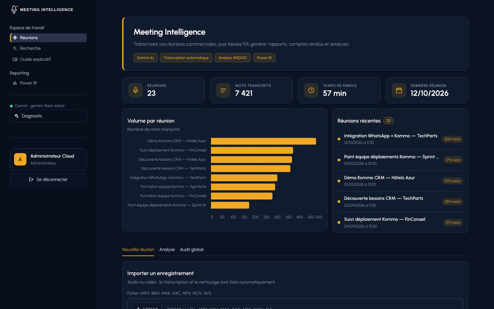
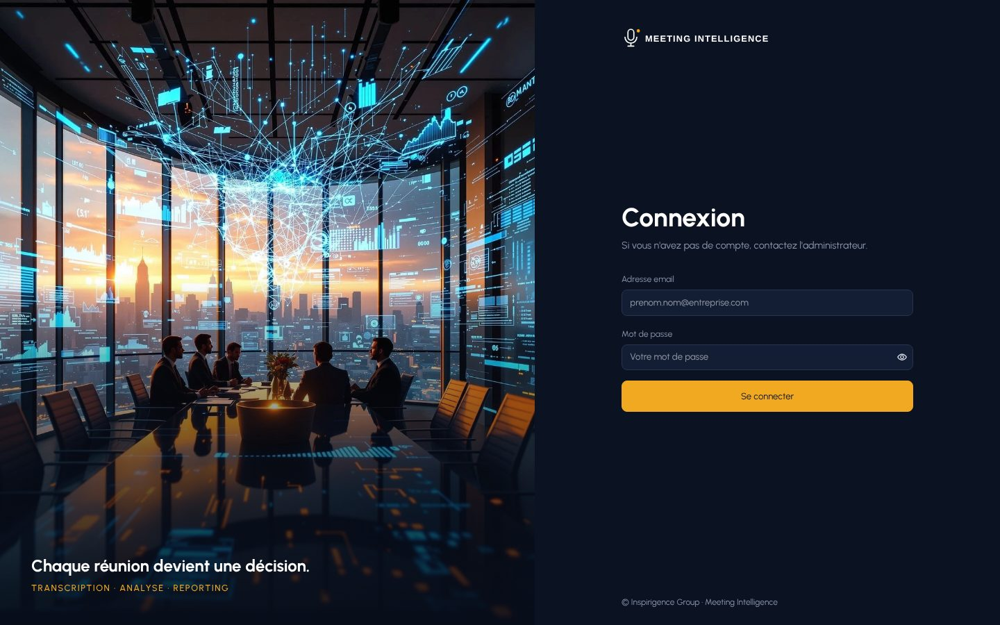
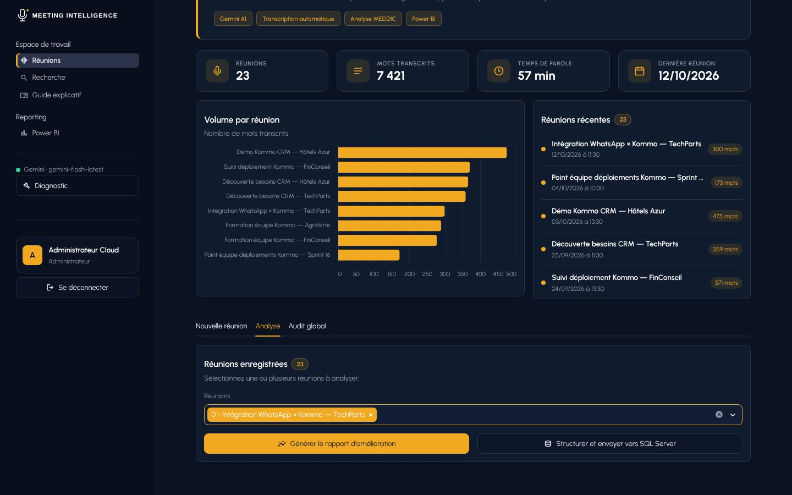
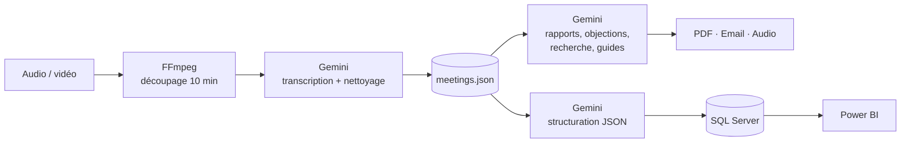

# 🎙️ Meeting Intelligence

**Transformez vos réunions commerciales en décisions grâce à l'IA.**

Meeting Intelligence transcrit automatiquement vos réunions (audio ou vidéo) avec Google Gemini, puis génère des rapports d'amélioration selon la méthode MEDDIC, des comptes rendus PDF, des emails de suivi et une analyse des objections clients. Les données structurées alimentent SQL Server et un tableau de bord Power BI.




> Les captures montrent le **mode démo** : réunions fictives sur le déploiement du CRM Kommo (entreprises et personnes inventées).

---

## ✨ Fonctionnalités

| | Fonctionnalité | Description |
|---|---|---|
| 🎙️ | **Transcription automatique** | Audio ou vidéo (MP3, WAV, M4A, MP4…), en français, anglais ou mixte. Les réunions longues sont découpées en segments de 10 minutes. |
| 📊 | **Rapport d'amélioration MEDDIC** | Analyse de la réunion avec un score global et des recommandations, export PDF. |
| 📝 | **Compte rendu formel** | Document de type « minutes », modifiable avant export PDF, avec une version audio. |
| ✉️ | **Email de suivi** | Brouillon prêt à envoyer, basé sur l'analyse. |
| ⚠️ | **Détection des objections** | Freins du client repérés automatiquement, avec des réponses suggérées. |
| 🔍 | **Recherche en langage naturel** | « Quel budget le client a-t-il évoqué ? » : les passages pertinents avec leur horodatage. |
| 📚 | **Guide explicatif** | Un guide complet sur un sujet abordé dans plusieurs réunions (produit, outil, processus). |
| 📈 | **Audit global & Power BI** | Synthèse de toutes les réunions ; données structurées envoyées vers SQL Server pour Power BI. |

## 📸 Aperçu

| Connexion | Analyse des réunions |
|---|---|
|  |  |

## 🏗️ Architecture



## 🛠️ Technologies

| Domaine | Outils |
|---|---|
| Interface | Streamlit, HTML/CSS, Altair |
| Intelligence artificielle | Google Gemini (`google-generativeai`), prompt engineering, méthode MEDDIC |
| Audio | FFmpeg (`imageio-ffmpeg`), pydub, gTTS |
| Données | JSON, Microsoft SQL Server (`pyodbc`), Power BI |
| Documents | fpdf2 |
| Sécurité | bcrypt, variables d'environnement (`python-dotenv`) |
| Qualité | pytest, ruff, GitHub Actions |

---

## 🚀 Installation

**Prérequis :** Python 3.10 ou plus récent et une clé API Gemini ([Google AI Studio](https://aistudio.google.com/app/apikey)). SQL Server est optionnel. FFmpeg est fourni par `imageio-ffmpeg`, rien à installer à part.

```bash
git clone https://github.com/Redar2002/meeting-intelligence.git
cd meeting-intelligence
python -m venv venv
```

Activer l'environnement virtuel :

```bash
# Windows (PowerShell)
.\venv\Scripts\Activate.ps1
# Linux / macOS
source venv/bin/activate
```

```bash
python -m pip install -r requirements.txt
```

### Configuration

Copier `.env.example` en `.env` (`copy .env.example .env` sous Windows), puis renseigner :

| Variable | Rôle |
|---|---|
| `GEMINI_API_KEY` | Clé API Gemini (obligatoire) |
| `ADMIN_EMAIL` / `ADMIN_PASSWORD` | Compte administrateur sans SQL Server. Si l'un des deux est vide, ce compte est désactivé. |
| `DEMO_MODE` | `1` pour afficher les réunions de démonstration (voir plus bas) |
| `POWERBI_URL` | Lien d'intégration de votre rapport Power BI (facultatif) |

Avec SQL Server, créer un administrateur en base : `python scripts/create_admin.py`.

Pour corriger automatiquement des mots souvent mal transcrits (noms propres, produits), copier `glossary.example.json` en `glossary.json` et l'adapter.

### Lancement

```bash
python -m streamlit run app.py
```

L'application s'ouvre sur http://localhost:8501.

## 🎬 Mode démo

Pour présenter le projet sans montrer de vraies réunions, ajouter `DEMO_MODE=1` dans `.env`. L'application charge alors 23 réunions fictives (`demo/meetings_demo.json`) sur le déploiement du CRM Kommo et masque l'email dans la barre latérale. Les vraies réunions ne sont pas modifiées.

Les réunions de démonstration se régénèrent avec `python scripts/generate_demo_data.py`.

## ☁️ Déploiement sur Streamlit Cloud

Dans **Settings → Secrets** de l'application :

```toml
GEMINI_API_KEY = "..."
ADMIN_EMAIL = "..."
ADMIN_PASSWORD = "un-mot-de-passe-fort"
DEMO_MODE = "1"
```

Sur Streamlit Cloud, le disque est réinitialisé à chaque redémarrage : les réunions ajoutées depuis l'interface ne sont pas conservées.

## 📁 Structure

```
app.py              Point d'entrée : thème, connexion, navigation, barre latérale
views/              Pages : réunions (accueil), recherche, guide explicatif, Power BI
services/           Logique IA (analyse.py) et modèle Gemini partagé (modele.py)
ui/                 Thème (theme.css) et composants visuels réutilisables
utils_*.py, auth.py Transcription, PDF, SQL Server, authentification
assets/             Logo de l'interface et photo de la page de connexion
demo/               Réunions fictives du mode démo
scripts/            Outils en ligne de commande (create_admin, populate_sql, generate_demo_data…)
docs/               Captures d'écran
tests/              Tests automatiques (pytest)
```

Les couleurs et la police sont dans `.streamlit/config.toml`, les styles complémentaires dans `ui/theme.css`. Pour changer la photo de connexion, remplacer `assets/login.jpg`.

## ✅ Tests

```bash
python -m pip install -r requirements-dev.txt
python -m pytest
ruff check .
```

Ces vérifications tournent automatiquement sur GitHub à chaque push (`.github/workflows/ci.yml`).

---

Projet réalisé chez **Inspirigence Group**.
